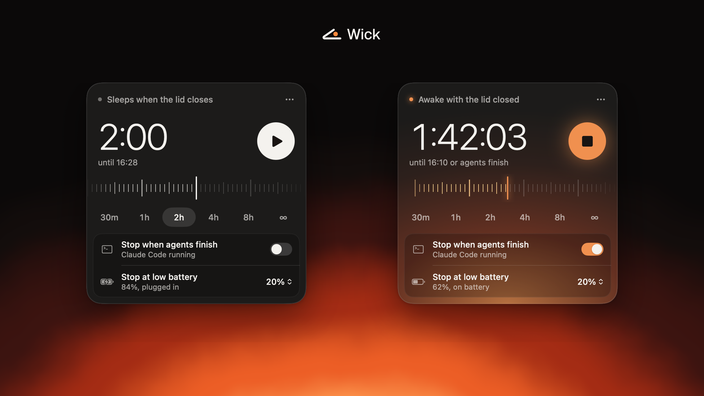

<p align="center">
  
</p>

# Wick

Close the lid. Keep working.

**[s1lvazxy.github.io/wick](https://s1lvazxy.github.io/wick/)**

Wick is a menu bar app and CLI that keeps your Mac awake with the lid closed, so coding agents, builds and downloads finish while you walk away. It wraps `pmset disablesleep`, the one setting that survives closing the lid, and makes sure it gets turned off again.

## Install

```sh
brew install --cask s1lvazxy/tap/wick
```

Or with npm, which downloads the release and checks its SHA-256:

```sh
npx wick-mac
```

Or [download the zip](https://github.com/s1lvazxy/wick/releases/latest) and drag Wick to Applications. Early builds aren't notarised, so the first time, open **System Settings → Privacy & Security** and choose **Open Anyway**.

Needs macOS 14 or later. Runs on Apple silicon and Intel.

## Use

Click the mark in your menu bar, pick a duration, press play, close the lid. The first time, macOS asks for your password once (see [Permission](#permission)).

From the terminal:

```sh
wick on 2h              # stay awake for two hours
wick on                 # until `wick off`
wick on --agents        # until your coding agents finish
wick on 8h --floor 30   # stop at 30% battery instead of 20%
wick run claude         # stay awake while one command runs
wick off                # back to normal
wick status             # what's going on
wick agents             # which agents Wick can see
```

## What stops a session

| Trigger | Behaviour |
| --- | --- |
| Time runs out | Enforced by a separate process, so it still happens if the app crashes or the terminal closes. A command under `wick run` holds it open until it exits |
| Battery floor | 20% by default, only while on battery. Change it or turn it off |
| Critical heat | macOS reports a critical thermal state. Always on |
| Agents finish | Optional. 90 seconds after the last one exits. An agent left open at its prompt still counts as running |
| The command exits | For `wick run`, including if `wick run` itself is killed |
| Quit, log out, shut down | Sleep comes back |
| Someone else changes it | Wick notices and lets go |

A guard force-killed with `SIGKILL` can't clean up after itself, so a small launchd job (`~/Library/LaunchAgents/io.github.s1lvazxy.wick.guard.plist`) runs the guard at login and every five minutes. It exits at once unless a session needs enforcing. macOS lists it under Login Items as `wick`.

**Keep it out of bags while it's awake.** A closed Mac sheds heat slowly, and no software fixes that.

## Permission

Changing this setting needs root. Wick adds one file, `/etc/sudoers.d/wick`, after checking it with `visudo`:

```
you ALL=(root) NOPASSWD: /usr/bin/pmset -a disablesleep 0, /usr/bin/pmset -a disablesleep 1
```

It allows those two exact commands and nothing else. The trade-off: any process running as you can also flip this setting without a password. It can't do anything else with the rule, but it could keep your Mac awake.

A sudoers rule rather than a privileged helper because it needs no Apple Developer ID, and you can read all of it in one line. `wick uninstall` removes it, along with the launchd job. `brew uninstall --cask wick` keeps the rule, since Homebrew runs the same steps on every upgrade and an upgrade shouldn't cost a password prompt, so run `wick uninstall` first, or use `brew uninstall --zap --cask wick`.

## How it's built

Swift 6, SwiftUI and AppKit, with no dependencies. The app is 5 MB.

```
Sources/WickCore        the setting, sessions, the guard, agent detection, the sudoers rule
Sources/wick            the CLI, which is also the guard process
Sources/WickUI          the panel, the ruler, the menu bar item
Sources/WickApp         the app's entry point
Sources/wick-snapshots  renders every panel state to PNG
brand/                  logo, icon, and the scripts that generate them
site/                   the landing page (Vite)
packaging/              the Homebrew cask and the npm installer
```

The session file in `~/Library/Application Support/Wick` is the single source of truth. The app and the CLI write it, and the guard enforces it.

```sh
swift test             # unit tests
scripts/e2e.sh         # drives the CLI and guard against a simulated setting, no root needed
scripts/build-app.sh   # builds dist/Wick.app and a zip. Needs Xcode 26 for the icon
```

### Releasing

Push a tag like `v0.2.0`. [`release.yml`](.github/workflows/release.yml) builds, publishes to GitHub Releases, updates the tap and publishes to npm. Its header lists the secrets, all optional. With a Developer ID it also signs and notarises, after which the cask's quarantine step can go and Wick can apply to the official Homebrew cask list.

## Why not caffeinate?

`caffeinate` stops idle sleep, but closing the lid still puts the Mac to sleep. Only `disablesleep` survives that.

## License

[MIT](LICENSE). The Wick name and logo are in [brand/](brand).
