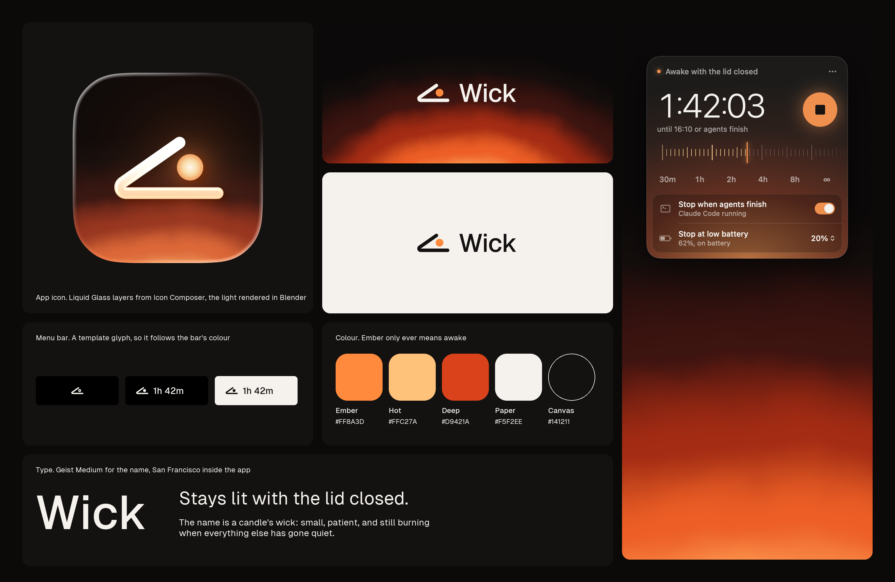

# Wick brand



## The idea

A candle's wick is small, patient, and still burning when everything else has gone quiet. The mark is a laptop seen from the side with its lid just ajar, and the ember lit inside it. Closed, it collapses into two lines with the ember at the tip, which is also a wick.

## Logo

| File | Use |
| --- | --- |
| `logo/lockup-dark.svg`, `lockup-light.svg` | The default, on light and dark |
| `logo/lockup-mono-dark.svg`, `lockup-mono-light.svg` | Where only one colour is possible |
| `logo/mark-dark.svg`, `mark-light.svg`, `mark-mono.svg` | Small spaces |
| `logo/wordmark-light.svg` | Very large, as in the site's footer |
| `Wick.icon` | The app icon. Open it in Icon Composer |

The mark sits on a 24-unit grid. Its one stroke is 2 units wide, with round caps and joins, and the ember has a radius of 2.25. Keep clear space of one ember width around it. Below 16px, use the mono version.

## Colour

| Name | Hex | Role |
| --- | --- | --- |
| Ember | `#FF8A3D` | The accent. Only ever means awake |
| Hot | `#FFC27A` | Lit ticks, warnings on dark |
| Deep | `#D9421A` | The far end of the glow |
| Paper | `#F5F2EE` | Text on dark, primary controls |
| Canvas | `#141211` | Surfaces |
| Night | `#0C0A09` | The darkest page background |

The rule that holds it together: if something is ember, it's on. Don't use ember for decoration, links or selection inside the product.

## Type

- **Geist Medium** (SIL Open Font License) for the name and for headlines. The word is outlined in the logo files, so never retype it.
- **San Francisco** inside the app, as on any Mac app.
- **Geist Mono** for commands on the website.

## Light

The glow comes from a Blender render, not from a CSS gradient: a coal below the frame, warped with noise, with a dithered 16-bit ramp so the dark end doesn't band. Use it rising from the bottom edge, as the panel, the icon and the site do.

## Regenerating

```sh
Blender -b -P brand/src/render.py -- <out> 128      # glow.png and coal.png
python3 brand/src/layers.py <out>                   # the mark's layers for Wick.icon
python3 brand/src/lockup.py Geist-Medium.ttf brand/logo
swift run wick-snapshots <snapshots>
python3 brand/src/board.py <snapshots> <icon.png> <coal.png> Geist-Regular.ttf Geist-Medium.ttf
python3 brand/src/site_shots.py <snapshots> site/public
```

Geist's font files come from the `geist` package on npm. `icon.png` is exported from `Wick.icon` with `ictool`, which ships inside Icon Composer.
